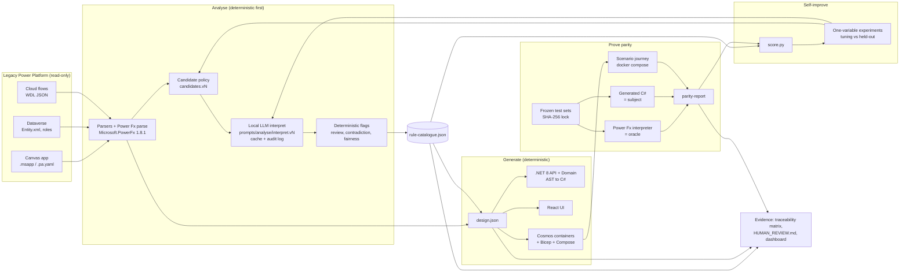

# Architecture

The factory is a Python package (`factory/`) plus a small .NET Power Fx host (`tools/fxhost/`). Every stage reads committed inputs and writes committed, diffable artefacts, so CI can rerun any stage and fail on drift.

Exported SVG: [architecture.svg](architecture.svg).

## Stages and trust boundaries

| Stage | Who decides | LLM role | Output |
|---|---|---|---|
| Parse | Deterministic parsers, Power Fx parser | none | `factory/out/<app>/model.json` |
| Candidate selection | Versioned deterministic policy | none | candidate sites |
| Interpretation | LLM, constrained JSON | writes the plain-English statement and category | catalogue fields marked as model output |
| Flags | Deterministic code (ADR-008) | none: cannot set or clear review flags | `flags` |
| Generate | Deterministic AST to C# transpiler | none | `generated/<app>/` |
| Parity | Power Fx interpreter vs generated C# | none | `parity/reports/<app>/` |
| Improve | `score.py` + keep/revert rule | critic proposes one change | `experiments/` |

## Target architecture (Azure)

- **API**: ASP.NET Core 8 minimal API in Azure Container Apps, with built-in auth (Entra ID). Legacy security roles become Entra app roles; BusinessUnit-scoped privileges need a `businessUnit` claim and fail closed without one.
- **Data**: Cosmos DB for NoSQL, one container per Dataverse table. Each partition key and the reason for it are recorded in `design.json`; child rows are partitioned by their parent so the app's reads stay single-partition. Bicep sets `disableLocalAuth: true`. The offline demo uses a file-backed store with the same partition-key contract; `docker compose --profile cosmos` runs against the Cosmos emulator instead.
- **Flows**: mapped in `design.json` to Azure Functions (timer and Cosmos change-feed triggers) or Durable Functions orchestrations. These are **design only**. No function code is generated (see `KNOWN_FAILURES.md`).
- **UI**: React + Vite static build, served by nginx in Compose. In Azure it would be served by Static Web Apps, but browser sign-in is not implemented (Q6).
- **IaC**: `generated/<app>/infra/main.bicep` (compiles in CI; never deployed in this run).
